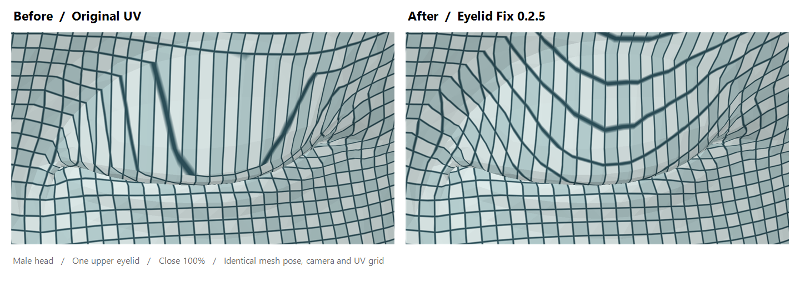

# HS2 Eyelid Fix v1.0

A BepInEx plugin for Honey Select 2 (Unity 2018) that reduces vertical texture stretching when a character blinks, winks, or squeezes their eyes shut.



**Left:** original UVs. **Right:** version 0.2.5. Both panels show the same stock male head at full eye closure, with the same camera and checker texture. At the center of the upper lid, the original mapping stretches a single row of squares across most of the visible skin. The correction distributes several rows over that surface. This comparison was rendered from the mesh and UV data.

## Incompatible

### Freelancer604 **Vanity Studio**

## Install

Download the ZIP from [GitHub Releases](https://github.com/itsnttt/HS2-EyelidFix/releases/latest) and extract it into your HS2 folder with the game and Studio closed. Allow the ZIP to replace the previous plugin DLL if prompted. Restart the player. To uninstall, close the player and remove the DLL.

## Expressions

The plugin reads the active blendshape weights on the head and eyelashes and adjusts UV0 on a runtime mesh copy. Supported expressions include ordinary and one-sided eye closure, warai and warai_cl, damage and its left/right variants, wink_R/L, wink_cl, wink_half, and ikari_cl. Returning their weights to zero restores the original UVs.

Stock male and female meshes were exercised in Unity 2018. Custom heads need readable meshes and compatible head/lash blendshape names. Results depend on the topology and texture; tightly folded or overlapping geometry can still distort.

## Build from source

Open [HS2-EyelidFix.sln](HS2-EyelidFix.sln) in Visual Studio and build the Release configuration. The [plugin source](src/HS2.EyelidFix/Plugin.cs) and [project file](src/HS2.EyelidFix/HS2.EyelidFix.csproj) are under src/HS2.EyelidFix. The project restores its compile-time references from NuGet. From a terminal, run `dotnet build HS2-EyelidFix.sln -c Release`.

For the alternative Unity compiler build, use a local HS2 installation with BepInEx and the Unity 2018.4.11f1 editor. From the repository root, run:

```powershell
./build.ps1 -GameDir 'D:/Games/HoneySelect2'
```

Pass `-EditorDir` if your Unity editor is installed elsewhere. The script writes the compiled DLL under `build/BepInEx/plugins/`.
